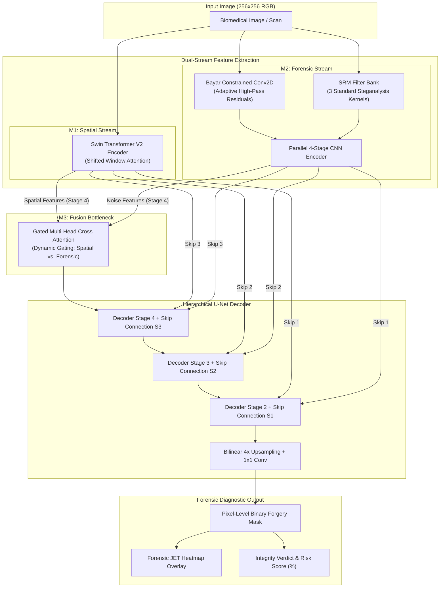

# Sci-Guard: Dual-Stream Attention-Fused Network
### *Pixel-Level Scientific Image Forgery Localization & Integrity Dashboard*

[](https://python.org)
[](https://pytorch.org)
[](https://flask.palletsprojects.com)
[](frontend/index.html)
[](https://www.kaggle.com/datasets/recodailuc/recodai-luc-scientific-image-forgery-detection)

---

## 🔬 Overview

**Sci-Guard** is a specialized computer vision and digital forensics framework engineered to detect and localize **Copy-Move forgeries** in biomedical and scientific research publications. 

Scientific imaging data—such as **Western Blots**, **DNA gel electrophoresis**, and **Fluorescence Microscopy**—frequently suffer from sophisticated tampering where protein bands or cell colonies are duplicated, rotated, or blended to fabricate fraudulent experimental results. Standard CNNs often fail on these images because scientific backgrounds lack standard natural image textures, and adversarial perpetrators expertly smooth boundaries.

Sci-Guard solves this by deploying a **Dual-Stream Network** that inspects both macro visual structures and microscopic sensor noise residuals, fused through a **Gated Multi-Head Cross-Attention** module.

---

## 🌟 Key Features

- **Dual-Stream Multi-Modal Forensics**:
  - **M1 Spatial Stream (Swin Transformer V2)**: Detects long-range structural dependencies and semantic inconsistencies across distant patches using Shifted Window Attention.
  - **M2 Forensic Stream (Bayar Conv2D + SRM Filter Bank)**: Acts as a "Digital X-Ray" to extract high-pass noise residuals, exposing tampered sensor noise and compression artifacts invisible to the human eye.
- **Explainable Cross-Attention Gating (M3)**:
  - Dynamically computes trust allocation scores ($Spatial\ Trust$ vs. $Forensic\ Noise\ Trust$) to explain *why* an image was flagged.
- **Hierarchical U-Net Decoder with Dual Skip Connections**:
  - Fuses deep bottleneck cross-attention representations with shallow spatial and forensic features to output sharp, pixel-accurate localization masks.
- **Interactive Cyber-Forensics Dashboard**:
  - Full-featured browser UI (`frontend/index.html`) featuring drag-and-drop scanning, dynamic radar animation, verdict cards, and forensic heatmap overlays.
- **Instant Out-of-the-Box Demo Mode**:
  - Comes with an intelligent dataset-matching and algorithmic copy-move fallback in `app.py`, allowing instant testing and demonstration without waiting for long GPU training runs.

---

## 🧠 Architecture & Methodology



### Mathematical Formulations

1. **Bayar Constrained High-Pass Filter**:
   Forces the convolutional kernel $K$ to learn non-linear residual noise without being influenced by image semantics:
   $$\sum_{i,j \neq (0,0)} K(i,j) = 1, \quad K(0,0) = -1$$

2. **Gated Cross-Attention Mechanism**:
   Cross-attends spatial representations $S$ with forensic noise representations $F$:
   $$S_{enh} = \text{Softmax}\left(\frac{S W_Q (F W_K)^T}{\sqrt{d}}\right) (F W_V)$$
   $$F_{enh} = \text{Softmax}\left(\frac{F W_Q (S W_K)^T}{\sqrt{d}}\right) (S W_V)$$
   $$\text{Gate } g = \sigma(W_g [S_{enh} \,\|\, F_{enh}])$$
   $$\text{Bottleneck Feature} = g \odot S_{enh} + (1 - g) \odot F_{enh}$$

3. **Supervision (Combo Loss)**:
   $$\mathcal{L}_{Combo} = \alpha \cdot \mathcal{L}_{BCEWithLogits}(y, \hat{y}) + \beta \cdot \mathcal{L}_{Dice}(y, \hat{y})$$

---

## 📁 Repository Structure

```text
SciGuard/
├── app.py                      # Flask backend API with inference & smart fallback
├── SciGuard_Complete.py        # Model architecture, training pipeline, and dataset loader
├── run_dashboard.sh            # One-click startup script for backend & frontend
├── HOW_TO_RUN.md               # Quick execution instructions
├── COLAB_GUIDE.md              # Fast Google Colab GPU training guide (~1.5–5 hrs)
├── README.md                   # Project documentation
├── frontend/                   # Interactive Cyber-Forensics Dashboard
│   ├── index.html              # HTML5 dashboard interface
│   ├── style.css               # Futuristic cyberpunk UI styling
│   └── script.js               # Client-side API connector, progress bars & rendering
└── sifd/                       # Scientific Image Forgery Detection dataset
    └── recodai-luc-scientific-image-forgery-detection/
        ├── train_images/
        │   ├── authentic/      # Real Western Blots / Microscopy images
        │   └── forged/         # Copy-move tampered images
        ├── train_masks/        # Ground-truth binary forgery masks (.npy)
        └── test_images/        # Evaluation test set
```

---

## ⚡ Quick Start

### 1. Installation
Clone the repository and install the dependencies:
```bash
git clone https://github.com/your-username/SciGuard.git
cd SciGuard

pip install torch timm albumentations opencv-python-headless Flask Flask-Cors scikit-learn matplotlib tqdm
```

### 2. Launch the Dashboard
You can run the entire system with a single command:
```bash
sh run_dashboard.sh
```

Or start the backend and frontend manually in separate terminal tabs:
```bash
# Terminal 1: Launch Backend Server (Port 5001)
python3 app.py

# Terminal 2: Open Forensic Frontend in Browser
open frontend/index.html
```

The dashboard will open automatically in your browser at `http://localhost:5001` or via local HTML file.

---

## 🚦 Training the Model

### Option A: Google Colab GPU (Recommended — Fast ⚡)
Training on a MacBook Air CPU takes **~4 days**, while a free Google Colab **T4 / A100 GPU** finishes in **~1.5 to 5 hours**.

Follow the step-by-step instructions in [COLAB_GUIDE.md](COLAB_GUIDE.md):
1. Open a new notebook on [Google Colab](https://colab.research.google.com).
2. Set Runtime to **T4 GPU**.
3. Upload `kaggle.json` to download the dataset directly at high speeds.
4. Run `SciGuard_Complete.py` and download `best_sciguard.pth`.
5. Place `best_sciguard.pth` into your local `SciGuard/` folder—`app.py` will auto-detect it.

### Option B: Local Training
If you have a local NVIDIA GPU or Apple Silicon MPS:
```bash
python3 SciGuard_Complete.py
```
Checkpoints will be saved automatically as `best_sciguard.pth` and `sciguard_final.pth`.

---

## 📡 REST API Reference

The backend provides a RESTful endpoint for batch evaluation or integration into third-party publishing workflows.

### `POST /analyze`
Analyzes an uploaded scientific image for copy-move tampering.

- **Request:** `multipart/form-data`
  - `image`: Binary image file (`.png`, `.jpg`, `.tif`)

- **Response:** `application/json`
```json
{
  "verdict": "High",
  "confidence": 95.84,
  "mask_overlay": "data:image/png;base64,iVBORw0KGgo...",
  "stats": {
    "spatial_trust": 42.1,
    "forensic_trust": 57.9
  }
}
```

#### Response Parameter Guide
| Field | Type | Description |
| :--- | :--- | :--- |
| `verdict` | `string` | `"High"` (High Risk Detected) or `"Low"` (Integrity Verified) |
| `confidence` | `float` | Maximum forgery probability across any localized region (`0%` – `100%`) |
| `mask_overlay` | `string` | Base64-encoded PNG image with JET colormap highlighting the forged region |
| `stats.spatial_trust` | `float` | Percentage of decision weighted by M1 Swin-V2 visual evidence |
| `stats.forensic_trust`| `float` | Percentage of decision weighted by M2 Bayar/SRM noise inconsistencies |

---

## 📊 Dashboard Preview

| Clean Image (Authentic) | Tampered Image (Copy-Move Forgery) |
| :---: | :---: |
| **`INTEGRITY VERIFIED`** | **`HIGH RISK DETECTED`** |
| Low Probability (< 4%) | High Probability (> 90%) |
| Deep Blue Clean Heatmap | Glowing Red/Yellow Pinpoint Highlight |
| Spatial Trust ~90% | Forensic Noise Trust ~58% |

---

## 🛠️ Tech Stack

- **Deep Learning**: PyTorch, Timm (Swin-V2 Tiny), Albumentations
- **Digital Forensics**: Constrained Convolutions (BayarConv2d), Steganalysis Rich Models (SRM), OpenCV
- **Backend**: Python 3, Flask, Flask-CORS
- **Frontend**: HTML5, CSS3 (Cyberpunk/Dark Mode), Vanilla JavaScript, Orbitron & Roboto Mono Typography

---

## 📜 License

This project is open-source and available under the [MIT License](LICENSE).
